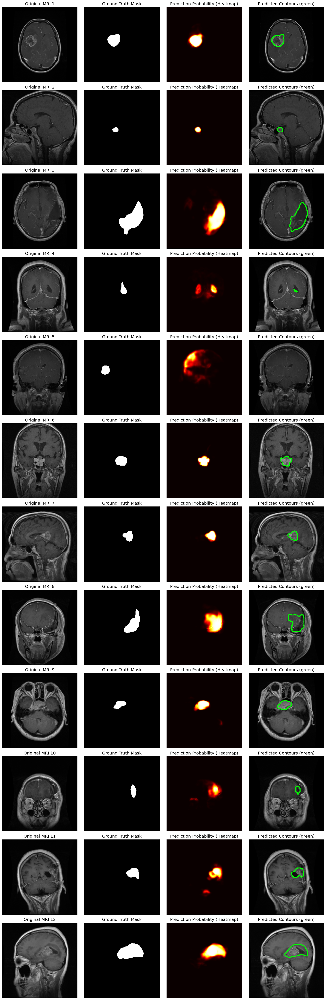

# Brain Tumour Segmentation with U-Net

Pixel-level segmentation of brain tumours in MRI scans using the U-Net architecture in PyTorch. This repository compares two approaches:

1. **U-Net with a pretrained ResNet34 encoder** (transfer learning from ImageNet)
2. **U-Net built from scratch** (classic architecture, randomly initialised)

Given an MRI slice, each model predicts a binary mask that marks the tumour region.

---

## Repository Structure

```
├── tumour_segmentation.ipynb              # U-Net with pretrained ResNet34 encoder
├── tumour_segmentation_using_UNET.ipynb   # U-Net implemented from scratch
├── assets/                                # Result images used in this README
└── README.md
```

---

## Dataset

**Brain Tumor Segmentation** dataset from Kaggle: [nikhilroxtomar/brain-tumor-segmentation](https://www.kaggle.com/datasets/nikhilroxtomar/brain-tumor-segmentation)

- 3,064 MRI brain images with corresponding binary tumour masks
- Every image contains a tumour; tumours cover a small fraction of each image, so background pixels heavily outnumber tumour pixels
- Split: 85% training / 15% validation (fixed random seed = 42)


---

## Methodology

### Preprocessing and Augmentation
- Images resized to **256 × 256**; masks binarised (pixel > 127 → tumour)
- Training augmentation (Albumentations): horizontal/vertical flips, 90° rotations, shift/scale/rotate, brightness/contrast changes
- Validation images are only resized and normalised

### Models

| | ResNet34 U-Net | U-Net from Scratch |
|---|---|---|
| Implementation | `segmentation_models_pytorch` | Custom PyTorch |
| Encoder | ResNet34, ImageNet-pretrained | 4 × DoubleConv blocks (64 → 512 filters) |
| Initialisation | Pretrained encoder | Random |
| Loss | 0.5 × BCE + 0.5 × Dice | BCE |
| Optimiser | AdamW (lr = 1e-3) | AdamW (lr = 1e-3) |
| LR Scheduler | ReduceLROnPlateau | ReduceLROnPlateau |
| Batch size | 8 | 8 |
| Epochs | 30 | Up to 100, early stopping (patience 12) |

**U-Net architecture:** an encoder downsamples the image to learn *what* is present, a decoder upsamples back to full resolution to learn *where* it is, and skip connections pass fine spatial detail from encoder to decoder for precise tumour boundaries.

### Evaluation Metric
**IoU (Intersection over Union / Jaccard Index)**, computed per image on the validation set with a 0.5 probability threshold, then averaged.

---

## Results

| Model | Best Val IoU | Approx. Dice* | Notes |
|---|---|---|---|
| U-Net + ResNet34 (pretrained) | **0.730** | 0.84 | 30 epochs, still improving at the end of training |
| U-Net from scratch | **0.711** | 0.83 | Early stopping at epoch 45 (best at ~epoch 33) |

\*Dice estimated from IoU using Dice = 2·IoU / (1 + IoU).

### Key Findings
- **U-Net is effective even without pretraining:** the scratch model reached 0.711 IoU from random initialisation using about 2,600 training images.
- **Pretraining mainly speeds up learning:** the pretrained model reached ~0.65 IoU after its first epoch, while the scratch model started near 0 and needed ~30 epochs to reach 0.70.
- **Both models generalised well:** training and validation losses stayed closely matched, supported by augmentation and early stopping.

> **Note:** the two experiments differ in both pretraining and loss function (BCE + Dice vs. BCE only), and each was run once on a single split. The ~2-point IoU gap should therefore be treated as indicative rather than conclusive.

### Visualisations


**Learning curves**


**Predictions: MRI, ground truth, probability heatmap, predicted contours**



---


### Requirements
```
torch
torchvision
segmentation-models-pytorch==0.3.1
timm==0.4.12
albumentations==1.3.0
torchmetrics==0.11.4
opencv-python
scikit-learn
matplotlib
seaborn
pillow
tqdm
```

---

